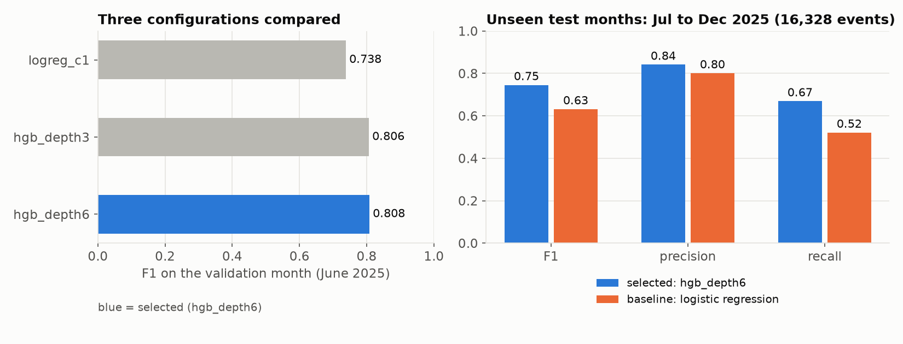
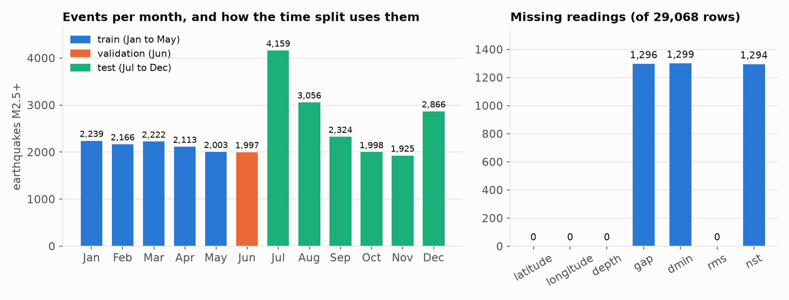
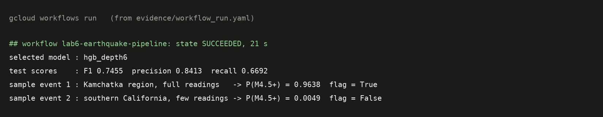
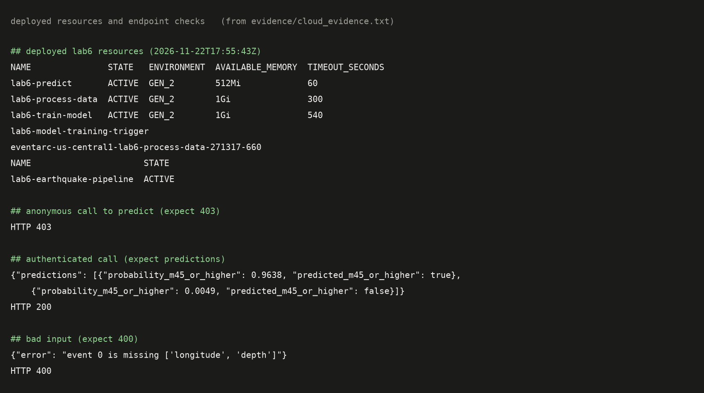

# Cloud Functions lab: a serverless ML pipeline on 2025 earthquake data

This is my version of `CloudFunction_Labs/Lab2 - CloudFunction_Intermediate`. The original chains three Cloud Functions with Pub/Sub and a Workflow, using Iris. I kept the idea (storage upload -> processing -> training -> serving, orchestrated by a Workflow) but I rebuilt it, because I do not think the original works as written (I read it, I did not run it), and I replaced the data and the model.

```
gs://BUCKET/raw/*.csv ──(Eventarc, object finalized)──> lab6-process-data
                                                              │ writes processed/clean.csv + quality_report.json
                                                              │ publishes to Pub/Sub topic lab6-model-training-trigger
                                                              ▼
                                                        lab6-train-model
                                                              │ writes models/model.joblib + models/metrics.json
                                                              ▼
 Workflow lab6-earthquake-pipeline ──(OIDC)──> lab6-predict (HTTP, not public)
```

## What I changed from the original lab

| Original | This version |
|---|---|
| Iris, `RandomForestClassifier` | 29,068 real earthquakes of 2025 (USGS). Predict whether an event is M4.5+ from location, depth and reading quality. Three configurations compared on a validation month, the best one scored on later months |
| `process_data` is a storage-triggered function, but the workflow calls it over HTTP, and `train_model` is Pub/Sub-triggered but is also called over HTTP. Those functions expect an event, not an HTTP request, so I do not think the workflow can work as written | The Workflow does something that does work: it re-uploads the raw file (copy in place, which fires the real storage trigger), waits for a model newer than its start, reads the metrics and calls the serving function |
| gen1 functions, `python310`, `--trigger-resource`, `--trigger-event` | gen2 functions, Python 3.12, Eventarc triggers |
| `--allow-unauthenticated` prediction endpoint | Prediction endpoint needs an identity token (anonymous call returns 403) |
| Hard-coded `PROJECT_ID` and `BUCKET_NAME` edited into the source | Read from environment variables, nothing project-specific is in the code |
| Three topics, only one is used | One topic, the one that is used |
| No checks of the data | Cleaning step with a quality report (missing columns, ranges, duplicates, missing readings) |
| Random split | Split by time: train before June, validate in June, test July to December |

## Results (from the run in the cloud)

- `raw/usgs_earthquakes_2025.csv` -> 29,068 rows in, 29,068 out. 29.4% of events are M4.5+. `gap`, `dmin` and `nst` are missing for about 1,300 events each (`evidence/quality_report.json`).
- Selected model: `hgb_depth6` (histogram gradient boosting). Validation F1 0.808, against 0.806 for the shallower boosting model and 0.738 for logistic regression.
- On July to December (16,328 events, never seen in training): **F1 0.746**, precision 0.841, recall 0.669. The logistic regression baseline gets F1 0.632 (`evidence/metrics.json`).
- The Workflow run took about 20 seconds and returned the metrics plus predictions for two sample events: a Kamchatka-area event with full readings (0.964 probability of M4.5+) and a small southern California event with most readings missing (0.005) (`evidence/workflow_run.yaml`).
- The anonymous call to the serving function returned 403, the authenticated call 200, and a call with missing fields 400 (`evidence/cloud_evidence.txt`).
- Running the same code locally with the same library versions gives identical metrics (`local_test.py`).

### Figures



*Left: the three configurations on the validation month, the best one in blue. Right: the selected model against the logistic regression baseline on July to December, which the model never saw. Drawn from `evidence/metrics.json`, which the training function wrote to the bucket.*



*Left: events per month and how the time split uses them. July is by far the busiest month. In the ELK lab I traced that to the aftershocks of the M8.8 Kamchatka earthquake and a swarm near Sand Point, Alaska, so the test months are not like the training months. Right: the readings that are missing (`gap`, `dmin`, `nst`). The model has to handle those, which is why the sample event with few readings in the workflow run still gets a prediction. Drawn from `data/usgs_earthquakes_2025.csv` and `evidence/quality_report.json`.*



*The result of the Workflow run in the cloud. It is the saved output of `gcloud workflows run`, laid out as an image (`evidence/workflow_run.yaml`).*



*The deployed functions, topic and workflow, and the three calls to the serving function: anonymous (403), with a login (200) and with missing fields (400). It is the saved text in `evidence/cloud_evidence.txt`, laid out as an image.*

The charts and the two command-output images are drawn by `make_figures.py` from the saved evidence and the data, so no number in them was typed by hand. They are not screenshots of the Google Cloud console.

## Run it

`deploy.sh` has every command I ran. It needs a project with billing and `PROJECT`, `ACCOUNT` and `PROJECT_NUMBER` set. `python make_figures.py` redraws the figures (needs matplotlib). `python local_test.py` runs the three stages' logic offline (needs the pinned requirements, Python 3.12).

## Problems I hit and what I did about them

- **Project creation is disabled** for my university account, so I had to use an existing team project. Everything I created is prefixed `lab6-`. I deleted all of it afterwards (functions, workflow, topic, buckets, the build-artifact repository, the service account and the IAM roles I added) and checked the project against a listing I took before starting (`evidence/cleanup_verification.txt`). The seven APIs I enabled are still on.
- **A deploy failed with a 403 about `serviceusage.services.use`.** My own account had the permission. Eventarc checks the trigger's service account, so I granted `roles/serviceusage.serviceUsageConsumer` to the pipeline's service account.
- **The storage trigger fired but nothing ran** (`run.routes.invoke` warnings in the log). With a custom trigger service account, Eventarc does not grant `run.invoker`. I granted it on the three Cloud Run services. Eventarc then retried and the first stage ran.
- **Training crashed on dates.** The cleaned CSV had timestamps with and without fractional seconds, which pandas refused to mix. My local test missed it because it never wrote the CSV and read it back. I now write one fixed time format, parse with `format="ISO8601"`, and `local_test.py` does the same round trip.
- **The first Workflow run failed with "IAM permission denied".** The Workflows service agent had just been created. A retry about a minute later succeeded with no change.

## Notes and limits

- One dataset and one run. The model is a toy, as in the other labs, and the lab is about the pipeline.
- The first training run after a deploy is a cold start. I did not measure cold start times or costs.
- The storage trigger fires for every object in the bucket, so the function ignores anything outside `raw/*.csv`. The Workflow's re-upload overwrites the raw file with an identical copy.
- No console screenshots: I worked from the command line and deleted the resources afterwards, so the evidence is saved command output and charts drawn from it.
- I did not set a budget alert, because that needs another API.
- The functions and workflow no longer exist, so the cloud run cannot be repeated without redeploying. `deploy.sh` does that.
