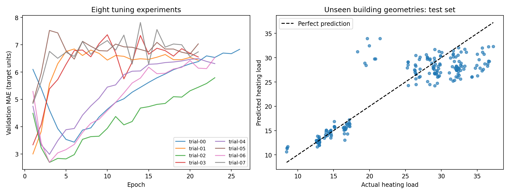
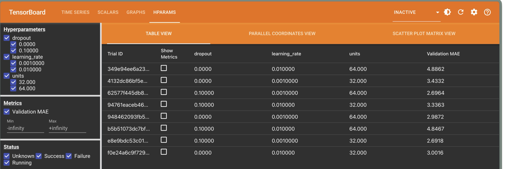
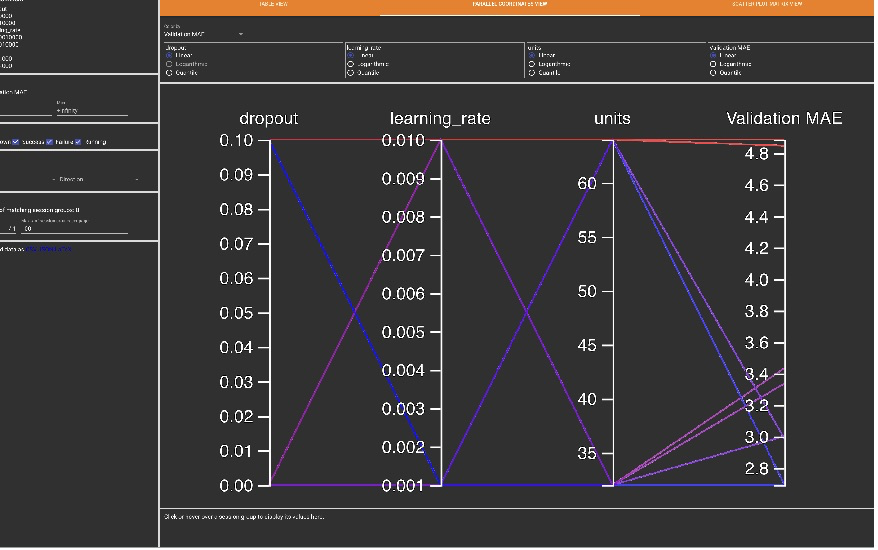

# Building Heating Load Prediction with TensorBoard

**Course:** Machine Learning Operations<br>
**Name:** Allen Febi Mariaantony Alphonsa<br>
**Email:** mariaantonyalphons.a@northeastern.edu<br>
**Date:** November 1, 2026

## Project idea

I built a TensorFlow regression experiment to predict a building design's heating load from eight design features. I used TensorBoard to record training curves and compare eight hyperparameter combinations. I selected a model using validation mean absolute error (MAE), then evaluated that checkpoint on held-out building geometries.

This is an original application of the tracking workflow in [TensorBoard Lab 4](../Lab4.ipynb). The dataset, prediction task, preprocessing, split design, evaluation, and experiment code differ from the course example. The completed [notebook](building_heating_load.ipynb) includes executable code and recorded outputs. All documentation and evidence are in this folder.

## Changes from the Original Lab

| Part | Original Lab 4 | My project |
|---|---|---|
| Problem | Fashion-MNIST clothing classification | Building heating-load regression |
| Input data | 28 × 28 grayscale images | Eight building-design features |
| Output | Ten-class softmax | One continuous value |
| Preprocessing | Divide image pixels by 255 | Fit numeric scaling on training rows; one-hot encode orientation and glazing distribution; scale training targets |
| Data split | Evaluate each tuning run on the test set | Grouped training/validation/test split; select only by validation MAE |
| Search | Width, dropout, optimizer | Width, dropout, Adam learning rate: eight combinations |
| Training | One epoch per run | Up to 150 epochs; patience 20; restore best validation-MAE weights |
| Evaluation | Classification accuracy | MAE, RMSE, R², training-mean baseline, and actual-versus-predicted plot |
| Evidence | HParams dashboard | HParams sessions, epoch curves, executed notebook, saved model, predictions, split manifest, and verification output |

I retained the lab's main learning objective: record hyperparameters and metrics, run a small search, and inspect the results in TensorBoard. I wrote the application around a different domain rather than running the supplied image-classification example.

## Clone the repository

```bash
git clone https://github.com/all3n2601/mlops-course-labs.git
cd mlops-course-labs/Labs/Tensorflow_Labs/TensorBoard/Building_Heating_Load
```

The repository is a fork of [raminmohammadi/MLOps](https://github.com/raminmohammadi/MLOps). This folder is the lab submission. The original course notebooks remain available alongside it.

## Data and split

I used the [UCI Energy Efficiency dataset](https://archive.ics.uci.edu/dataset/242/energy+efficiency), created by Athanasios Tsanas and Angeliki Xifara (2012), DOI [10.24432/C51307](https://doi.org/10.24432/C51307). It contains 768 Ecotect-simulated designs based on 12 building geometries. The unmodified workbook is included under its [CC BY 4.0 license](https://creativecommons.org/licenses/by/4.0/); see [data attribution](data/README.md).

| Column | Meaning | Treatment |
|---|---|---|
| X1 | Relative compactness | Numeric; also identifies geometry groups |
| X2 | Surface area | Numeric |
| X3 | Wall area | Numeric |
| X4 | Roof area | Numeric |
| X5 | Overall height | Numeric |
| X6 | Orientation | One-hot categorical: 2–5 |
| X7 | Glazing area | Numeric |
| X8 | Glazing-area distribution | One-hot categorical: 0–5 |
| Y1 | Heating load | Regression target |
| Y2 | Cooling load | Excluded from model inputs |

I grouped by X1 because each compactness value identifies one geometry with fixed X2–X5. Orientation and glazing variants of the same geometry stay in the same split. This avoids measuring performance on near-duplicate shapes seen during training. `GroupShuffleSplit` uses seed 42 for both splits. Exact row indices and geometries are retained in [splits.json](results/splits.json) and [summary.json](results/summary.json).

The six numeric predictors use training-set means and standard deviations. The two categorical predictors produce ten one-hot columns, for 16 model inputs altogether. Their allowed categories are fixed from the dataset definitions rather than inferred from test values. The heating-load target is standardized using only training labels. I convert predictions back to the original target scale before reporting metrics. I do not infer physical units that the UCI variable table does not specify.

## Experiment setup

Each network has two ReLU hidden layers, a dropout layer after the first hidden layer, and a single linear output. The second hidden layer has half as many units as the first. Training minimizes standardized-target MSE using Adam and batches of 32.

| Hyperparameter | Values |
|---|---|
| First hidden-layer units | 32, 64 |
| Dropout | 0.0, 0.1 |
| Learning rate | 0.001, 0.01 |

The 2 × 2 × 2 grid gives eight trials. Each uses seed 42, a 150-epoch limit, and early stopping after 20 epochs without validation-MAE improvement. Best weights are restored before calculating the final validation metric. The selected model is the trial with the lowest validation MAE. I do not refit after selection; I evaluate its restored checkpoint on the test set.

Epoch MAE in Keras/TensorBoard is on the standardized target scale. The HParams metric named `validation_mae`, the comparison CSV, and reported final metrics are in original target units. They should not be compared directly with standardized epoch MAE without multiplying the latter by the saved target standard deviation.

## Run with Docker

The recorded execution uses CPU-only Docker inside Ubuntu 22.04 ARM64 in UTM. No GPU or external service is required. Building the image downloads Python packages; the dataset is already included.

```bash
docker build -t tf-building-heating-load:lab .

# Inspect the included results without retraining.
docker run --rm -v "$PWD:/lab" tf-building-heating-load:lab python verify.py

# View the included experiment in TensorBoard.
docker run --rm -p 127.0.0.1:6006:6006 -v "$PWD:/lab" \
  tf-building-heating-load:lab \
  tensorboard --logdir /lab/logs --host 0.0.0.0 --port 6006
```

Open **http://localhost:6006**. Select **HParams** for the experiment table, parallel coordinates, and scatter plots. Select **Time Series/Scalars** for epoch curves. The port is published only on the Docker host's loopback interface.

To reproduce training, first move the included logs and results aside so that the recorded experiment is preserved:

```bash
mv logs logs-recorded
mv results results-recorded
docker run --rm -v "$PWD:/lab" tf-building-heating-load:lab
docker run --rm -v "$PWD:/lab" tf-building-heating-load:lab python verify.py
```

The default command executes every notebook cell and saves the notebook with outputs. For script-only training, replace the command with `python experiment.py`. A nonempty `logs/` directory causes training to stop rather than mix old and new trials. For another retraining run, use new backup names. If Docker creates root-owned output files on Linux, restore ownership using `sudo chown -R "$(id -u):$(id -g)" results logs building_heating_load.ipynb`.

## Run without Docker

Use Python 3.11 in a virtual environment:

```bash
python3.11 -m venv .venv
source .venv/bin/activate
pip install -r requirements.txt
python verify.py
tensorboard --logdir logs --host 127.0.0.1 --port 6006
```

For retraining, move the included logs and results aside as shown above, then run `python execute_notebook.py`. The [requirements file](requirements.txt) pins direct dependencies; the recorded environment's complete package versions are retained in `evidence/requirements-ubuntu.txt`. Other architectures may produce slightly different numeric results.

## Results and observations

I ran all eight trials inside Docker on Ubuntu 22.04 ARM64 in UTM using TensorFlow 2.20.0 and Python 3.11.18. The split contained **448 training rows (7 geometries), 128 validation rows (2 geometries), and 192 test rows (3 geometries)**.

| Trial | Units | Dropout | Learning rate | Best epoch | Validation MAE |
|---|---:|---:|---:|---:|---:|
| trial-00 | 32 | 0.0 | 0.001 | 6 | 3.4332 |
| trial-01 | 32 | 0.0 | 0.01 | 1 | 3.0016 |
| **trial-02** | **32** | **0.1** | **0.001** | **3** | **2.6918** |
| trial-03 | 32 | 0.1 | 0.01 | 1 | 3.3363 |
| trial-04 | 64 | 0.0 | 0.001 | 3 | 2.9872 |
| trial-05 | 64 | 0.0 | 0.01 | 1 | 4.8862 |
| trial-06 | 64 | 0.1 | 0.001 | 3 | 2.6964 |
| trial-07 | 64 | 0.1 | 0.01 | 1 | 4.8467 |

I selected **trial-02**, which used 32 and 16 hidden units, dropout 0.1, and Adam learning rate 0.001. It ran for 23 epochs and restored the weights from epoch 3. Trial-06 was very close on validation MAE (a difference of about 0.0046), so this single seed does not establish that the narrower model is consistently better. Trial-06 had a better validation RMSE, but I kept the MAE selection rule established before training.

| Held-out test metric | Selected model | Training-mean baseline |
|---|---:|---:|
| MAE | **2.8408** | 8.1046 |
| RMSE | **4.0029** | 8.6525 |
| R² | **0.7629** | -0.1079 |

The model's test MAE was about **65% lower** than the baseline. Validation error increased after only a few epochs in most runs, which shows why early stopping was useful for this small grouped dataset. The test scatter also shows underprediction for many high-load examples and overprediction for some midrange examples. I would not describe this model as ready for real-building use.



*Figure 1. Actual experiment output: validation MAE across epochs and predictions for the three unseen test geometries. The curves include the patience period; the saved model uses its best epoch, not its final epoch.*



*Figure 2. Genuine TensorBoard HParams table opened in Zen, showing all eight configurations and their validation MAE in original target units. TensorBoard generates hashed trial IDs; the parameter combinations map to the readable trial names in the table above.*



*Figure 3. Genuine TensorBoard parallel-coordinates view connecting dropout, learning rate, hidden width, and validation MAE. Lower values on the final axis are better.*

## Verification

`verify.py` checks that all 768 rows appear exactly once across the splits, that geometry groups do not overlap, and that preprocessing statistics come from training rows. It checks all eight trials, confirms that the selected run has the lowest validation MAE, reloads the exported Keras model, reproduces recorded predictions and test metrics, and reads the TensorBoard event files to check that their HParams metrics match the comparison CSV.

All verification checks passed in the Ubuntu container. The dependency check reported no broken requirements. Evidence: [verification output](evidence/verification-ubuntu.txt), [dependency check](evidence/dependency-check.txt), [runtime](evidence/runtime.txt), and [complete installed versions](evidence/requirements-ubuntu.txt).

## Files

| File | Purpose |
|---|---|
| [building_heating_load.ipynb](building_heating_load.ipynb) | Executed lab notebook |
| [experiment.py](experiment.py) | Training, tuning, selection, logging, and evaluation |
| [verify.py](verify.py) | Checks on actual experiment artifacts |
| [execute_notebook.py](execute_notebook.py) | Execute and save every notebook cell |
| [results/trials.csv](results/trials.csv) | Eight validation results |
| [results/summary.json](results/summary.json) | Selected configuration, metrics, splits, environment, and data hash |
| [results/test_predictions.csv](results/test_predictions.csv) | Actual and predicted held-out targets |
| [results/best_model.keras](results/best_model.keras) | Selected checkpoint |
| [results/preprocessing.json](results/preprocessing.json) | Numeric scaling and categorical encoding parameters |
| [logs/](logs/) | Genuine TensorBoard event files |
| [evidence/](evidence/) | Screenshots, terminal output, and environment versions |

## Limitations and follow-up

These data contain only 12 simulated geometries. A single grouped split provides limited evidence and can be sensitive to which geometries are held out. Hyperparameter search can also overfit the validation geometries. The results are not a claim about real utility bills, other climates, or arbitrary building designs. More useful follow-up work would repeat the experiment across geometry folds and seeds and test on independently measured buildings. GPU speedups and deployment performance were not measured.

## References and submission status

- Course source: [TensorBoard Lab 4](https://github.com/raminmohammadi/MLOps/blob/main/Labs/Tensorflow_Labs/TensorBoard/Lab4.ipynb), upstream commit `034eb50747db15a5c4c08fe61876f8300d7fd649`. The upstream CC0 license is retained at the repository root.
- TensorFlow: [HParams dashboard workflow](https://www.tensorflow.org/tensorboard/hyperparameter_tuning_with_hparams).
- Dataset: Tsanas, A. & Xifara, A. (2012). [Energy Efficiency](https://doi.org/10.24432/C51307), UCI Machine Learning Repository, CC BY 4.0.

Prepared for submission as a GitHub lab folder. No PDF is required. Publishing this folder does not submit it to the course portal.
